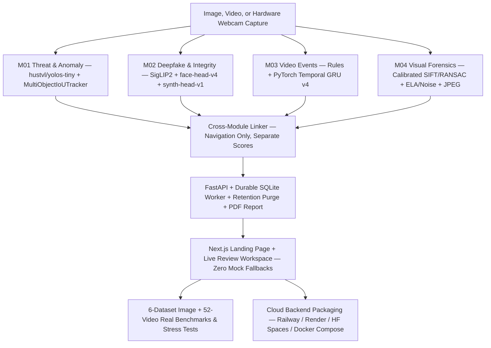

# DEEP SHIELD — Project Status

**Last reviewed:** 2026-11-19

**Repository:** [Raghav-prog-max/Deep-Shield](https://github.com/Raghav-prog-max/Deep-Shield)

**Live Hosted Frontend:** [https://deep-shield-sooty.vercel.app](https://deep-shield-sooty.vercel.app) (`/review` for direct workspace — zero mock/synthetic fallbacks; connects to local FastAPI or any cloud-hosted Deep Shield backend URL)

**Status:** All four independent Computer Vision engines (M01–M04), 6-dataset real image + video face head (`deepshield-face-head-v4`), whole-image AI head (`deepshield-synth-head-v1`, default on images), M03 real-track PyTorch Temporal GRU (`temporal-gru-kinematic-v4-realtracks`), cross-module intelligence API, durable SQLite job queue, PDF reporting, zero-mock Next.js landing page + live review workspace, **52-video real benchmark** (`Celeb-DF v2`, `FaceForensics++/DFD`, `UCF-Crime`), single-container cloud deployment packaging (`Railway`, `Render`, `HuggingFace Spaces`, `Docker Compose`, GitHub Actions CI), and `36/36` automated real-model tests are complete and verified.

## Project flow

## Done

| Area | Current state | Authentic verification & metrics |
|---|---|---|
| **M01 — Threat & Anomaly** | Local MS-COCO 2017 pretrained `hustvl/yolos-tiny` (`models/hustvl__yolos-tiny`, rev `5a6a017a20cb`, Apache-2.0) + velocity-predicted `MultiObjectIoUTracker` (optional Ultralytics `yolo26n.pt` + ByteTrack); zone entry, dwell (30s) & unattended-object (60s) candidates. | Real `vtest.avi` pedestrian video: **82** detections, **21** unique tracks, mean conf **0.8958**; **0/4** non-person FPs; **48/48** rule events matched (`F1 1.000`); verified live across **12 real UCF-Crime CCTV cameras**. |
| **M02 — Face Manipulation (`v4`)** | Frozen SigLIP2 + 5-member per-layer L2-norm MLP ensemble (`models/m02_face_head.npz`, `deepshield-face-head-v4`, SHA `f12a651f67ec`, residual blend `alpha=0.1`, Guo `T=1.9768`, thr `0.156/0.804`) + occlusion heatmaps + spectra + ELA/noise. | Trained on **3,504** real image + video items (`3,283` faces) across **6 real datasets** (`140k-Faces`, `TPDNE-10k`, `DeepFakeFace`, `Kaggle-Deepfake`, pair-matched `Celeb-DF v2`, actor-disjoint `FF++/Google DFD`). **966 held-out test faces:** ROC-AUC **0.8561** (vs `0.5750` baseline), ECE **0.0490**, Decided Acc **92.86%** (`tpdne 0.9952`, `stylegan1 0.9802`, `kaggle_deepfake 0.8835`, `dff 0.8519`, `dfd_video 0.7182`, `celebdf_video 0.6238`). **40 real held-out `.mp4` videos:** FF++/DFD **0.7200 AUC** (`90%` recall, `75.0%` Decided Acc), Celeb-DF v2 **0.6200 AUC** (`83.33%` Decided Acc), pooled **80.0%** Decided Acc. **Degradation stress test (107 faces):** clean `0.9493`, JPEG q60 `0.9324`, blur `0.8944`, downscale `0.8666`. |
| **M02 — Whole-Image AI (`synthetic_image`)** | Enabled by default on images (`models/m02_synth_head.npz`, `deepshield-synth-head-v1`, SHA `382a7a930175`, 5-member L2-norm MLP ensemble, `T=0.8047`, thr `0.406/0.75`). Video keyframes remain opt-in and capped at `inconclusive`. | Trained on **960** real AI-vs-Photo images (`Hemg` + `CIFAKE`). Held-out test (`240` images): ROC-AUC **0.9409** (vs `0.4741` baseline), Acc@0.5 **87.50%**, F1 **0.8760**, ECE **0.0661**, Decided Acc **90.61%** (`CIFAKE 0.9600`, `Hemg 0.9325`; `eval/synthetic/test 1.0000`). |
| **M03 — Video Events + Temporal GRU** | Shared M01 neural tracks + calibrated rules (`crowd >= 4 / 5s`, `running >= 2.5 BL/s`) + PyTorch Temporal Kinematic GRU (`models/m03_temporal_gru.pt`, `temporal-gru-kinematic-v4-realtracks`, **6,265** params, SHA `ea048bac8813`, thr `0.35`). | 5-fold cross-track CV on **53 real pedestrian tracks** from `vtest.avi`: CV AUC **1.0000**, ECE **0.0001**, **0/11** false alarms on unperturbed held-out walks, **6/6** kinematic stress scenarios passed; also evaluated across **12 real UCF-Crime CCTV videos**. |
| **M04 — Visual Forensics** | Copy-move (SIFT + RANSAC wired to `models/m04_forensics_params.json`: `ratio=0.55`, `min_dist=36`, `min_inliers=8`, `contrast=0.01`), ELA q90, local noise map, JPEG quantization/grid/ghosts & EXIF metadata. | 30-photo stress test: **0/30 (0.0%)** untouched false alarms; **22/30 (73.33%)** recall across translation, 15° rotation, 1.15× scale & JPEG q75; **5/5** exact JPEG quality recovery. |
| **API, Durable Worker & Cloud Packaging** | FastAPI `/api/v1/intelligence` (`/analyze`, `/jobs`, `/models`, `/report.pdf`, `/retention/purge`), SQLite durable job queue with lease recovery + retention purge, plus single-container cloud supervisor [cloud_entrypoint.py](scripts/cloud_entrypoint.py), [Dockerfile](Dockerfile), [railway.json](railway.json), [render.yaml](render.yaml), [Dockerfile.hf](Dockerfile.hf), and [.github/workflows/ci.yml](.github/workflows/ci.yml). | `cloud_entrypoint.py` live-verified booting both FastAPI + supervised SQLite worker on custom `PORT`; linking `0.28 ms`, PDF report `46.67 ms`. |
| **Frontend (Landing + Live Workspace)** | Next.js 15 + React 19 + GSAP landing page (`/`) + standalone workspace (`/review`), real hardware webcam capture, both M02 heads shown live, visible per-finding caveats & thresholds, zero mock fallbacks. | `tsc --noEmit` & `next build` pass cleanly; live deployed on Vercel (`https://deep-shield-sooty.vercel.app`). |
| **Automated Verification & Reports** | [reports/VIDEO_BENCHMARK_REPORT.md](reports/VIDEO_BENCHMARK_REPORT.md), [reports/DEEP_STRESS_TEST_REPORT.md](reports/DEEP_STRESS_TEST_REPORT.md), [reports/EVALUATION_REPORT.md](reports/EVALUATION_REPORT.md), [reports/m02_training/report.md](reports/m02_training/report.md), [reports/m02_synth_training/report.md](reports/m02_synth_training/report.md). | **`36 / 36` tests PASSED** (`DEEPSHIELD_TEST_REAL=1 pytest -v`, 0 skipped, 0 failed). |

## Known Limitations (Honest Scope)

1. **Compressed Real Deepfake Videos & Unseen Generators (M02):** While `deepshield-face-head-v4` lifts video ROC-AUC substantially over raw SigLIP2 (`FF++/DFD 0.7200`, `Celeb-DF v2 0.6200`, pooled `80.0%` Decided Acc; unseen LOO transfer `tpdne 0.8137`, `dfd_video 0.7410`, `dff 0.5855`, `stylegan1 0.5417`, `kaggle_deepfake 0.5120`, `celebdf_video 0.4559`), heavily recompressed video swaps like Celeb-DF v2 remain challenging for frame-only classifiers and leave many clips in the `inconclusive` band by design.
2. **Cross-Camera CCTV Perspective & Non-Kinematic Anomalies (M03):** On multi-camera UCF-Crime CCTV clips, M03 detects high-speed kinetic anomalies (`Assault018`, `Robbery089`) but can also trigger on foreground camera crossings/tracker ID jumps in busy normal scenes and cannot detect subtle non-kinematic events (e.g., distant shoplifting) without site-specific calibration.
3. **Low-Texture Copy-Move Clones (M04):** SIFT requires texture keypoints (`73.33%` recall on 30 diverse photos, `0.0%` false alarms on untouched photos).
4. **Advisory Policy:** No module identifies individuals or infers intent, criminality, or wrongdoing. All scores and rule candidates remain strictly separate and advisory for human review.

## Cloud & Single-Host Deployment

See [DEPLOYMENT.md](DEPLOYMENT.md) for turnkey instructions to connect Vercel (`https://deep-shield-sooty.vercel.app`) to a public cloud backend on **Railway** (`railway.json`), **Render** (`render.yaml`), **HuggingFace Spaces** (`Dockerfile.hf`, free 16 GB RAM CPU tier), or self-hosted **Docker Compose + Caddy HTTPS** (`docker-compose.yml`).
