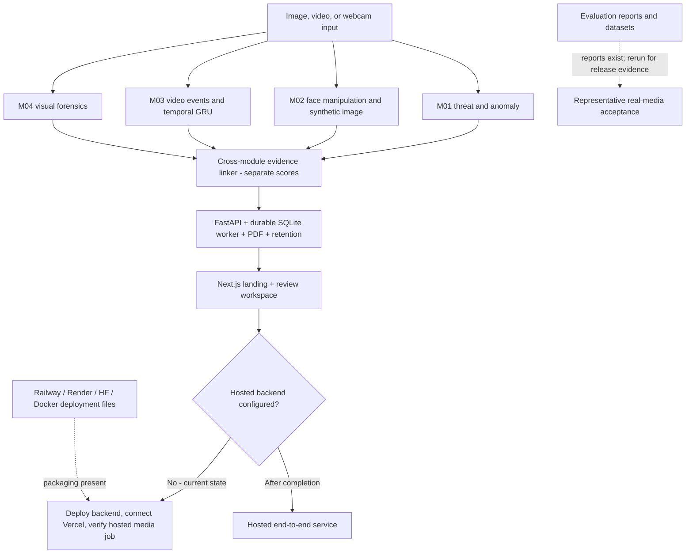

# Deep Shield - Project Status

**Reviewed:** 2026-11-19
**Repository:** [Raghav-prog-max/Deep-Shield](https://github.com/Raghav-prog-max/Deep-Shield)
**Reviewed commit:** `6206fd990feb0fc35dd6311a278c8acd31bb19a1` (`main`)

## Executive summary

The four analysis engines, API, durable SQLite worker, PDF reporting, frontend, evaluation assets, and deployment configuration are present in the repository. The Vercel landing page and review workspace are reachable. **The project is not yet verified as a hosted end-to-end service:** the public Vercel API health route returns 404, and no public backend URL is configured in the repository. Deploy and connect a backend before claiming hosted analysis works.

The latest GitHub Actions run for the reviewed commit passed both configured jobs. That CI run uses an M02 stub and excludes the deep-model media tests, so it does not verify every model with real inference. Benchmark figures below are recorded in the linked project reports; they were not rerun as part of this status review.

## Project flow and completion

| Stage | Status | Evidence / notes |
|---|---|---|
| M01-M04 engines and model assets | **Implemented** | Engine code is present. Trained M02 face and synthetic heads, M03 GRU, and M04 parameters are tracked. M01 YOLOS weights are downloaded during setup/CI rather than included in this clone. |
| Cross-module linker, FastAPI, SQLite worker, PDF and retention | **Implemented; local integration recorded** | The repository has a recorded integration run for job completion, worker lease recovery, evidence routes, PDF generation, and retention cleanup. This is not a hosted backend check. |
| Next.js landing and review workspace | **Implemented; frontend hosted** | On 2026-11-19, `/` returned HTTP 200 (95,349 bytes) and `/review` returned HTTP 200 (10,130 bytes). |
| GitHub Actions | **Passed for reviewed commit** | Run [44453823617](https://github.com/Raghav-prog-max/Deep-Shield/actions/runs/44453823617): backend test job and frontend typecheck/build job succeeded. Backend CI sets `DEEPSHIELD_M02_BACKEND=stub` and excludes `tests/test_deep_models_media.py`. |
| Model and media evaluation | **Reports present; independent rerun remains** | Evaluation reports and benchmark artifacts are in `reports/` and `eval/`. Their metrics are historical project results, not newly reproduced by this review. See [EVALUATION.md](EVALUATION.md). |
| Cloud deployment packaging | **Implemented; deployment remains** | Railway, Render, Hugging Face Spaces, and Docker Compose files are present. Packaging does not mean a backend service has been deployed. |
| Hosted backend and full hosted workflow | **Not complete** | `https://deep-shield-sooty.vercel.app/api/v1/m01/health` returned HTTP 404. Deploy the API + worker, configure the frontend to use that backend, and verify an image and video job through `/review`. |

## Evaluation results recorded in repository

These are reported results from project artifacts, not a fresh evaluation in this review:

- **M01:** `reports/VIDEO_BENCHMARK_REPORT.md` reports 82 detections and 21 tracks on `vtest.avi`, plus evaluation on UCF-Crime clips.
- **M02 face:** `reports/m02_training/report.md` reports ROC-AUC 0.8561 on its held-out face set and 0.7200 / 0.6200 video ROC-AUC on FF++/DFD and Celeb-DF v2.
- **M02 synthetic image:** `reports/m02_synth_training/report.md` reports ROC-AUC 0.9409 on its held-out test set.
- **M03:** the reports record a 5-fold track evaluation and kinematic stress scenarios. Validate these results on consented, representative deployment media before operational use.
- **M04:** `reports/DEEP_STRESS_TEST_REPORT.md` records a 30-photo stress test, with 0/30 untouched false alarms and 22/30 edited-image detections.

Dataset composition, splits, and caveats are documented in [EVALUATION.md](EVALUATION.md) and the reports. Do not treat benchmark scores as a guarantee of accuracy on new cameras, populations, or manipulations.

## Remaining work, in order

1. **Deploy a backend** using one documented target in [DEPLOYMENT.md](DEPLOYMENT.md); confirm that API and worker start, model weights load, persistent storage is configured, and health endpoints respond.
2. **Connect the frontend** by setting `NEXT_PUBLIC_API_BASE_URL` in Vercel to the deployed API URL and redeploying the frontend.
3. **Verify hosted analysis** from `/review` with consented representative images and videos. Confirm queued jobs, engine outputs, evidence links, PDF download, retention, and useful failure messages. Record the backend URL and exact verification time.
4. **Run and report release acceptance evaluation** on representative, consented media. Reproduce the claimed model tests in a real-model configuration; update CI/reporting so its test counts and skipped/excluded tests are explicit.
5. **Tune thresholds and document operating limits** from evaluation results. Keep all output advisory and require human review.

## Safety and scope

The outputs are advisory. The system must not identify people or infer intent, criminality, or wrongdoing. Real deployment requires review of consent, data handling, retention, security, and performance on the intended media before use.

## References

- [Deployment guide](DEPLOYMENT.md)
- [Evaluation guide](EVALUATION.md)
- [Deployment verification record](reports/DEPLOYMENT_VERIFICATION.md)
- [Video benchmark report](reports/VIDEO_BENCHMARK_REPORT.md)
- [Deep stress test report](reports/DEEP_STRESS_TEST_REPORT.md)
