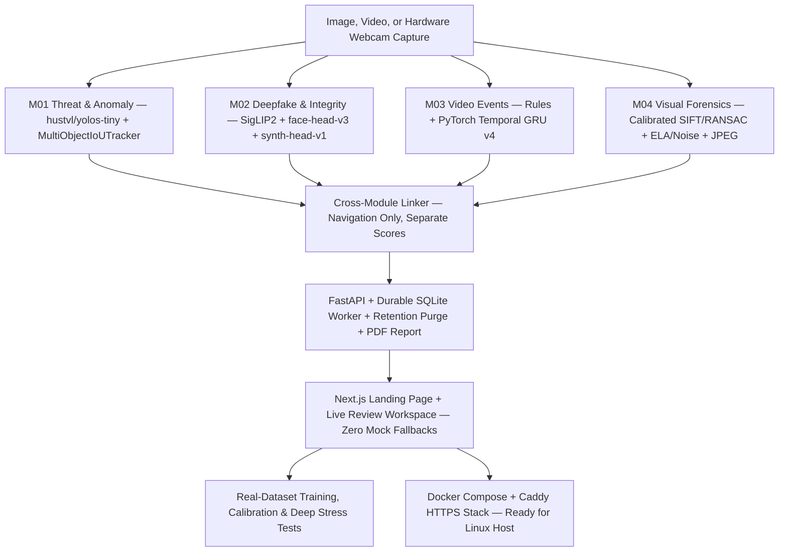

# DEEP SHIELD — Project Status

**Last reviewed:** 2026-11-19

**Repository:** [Raghav-prog-max/Deep-Shield](https://github.com/Raghav-prog-max/Deep-Shield)

**Live Hosted Frontend:** [https://deep-shield-sooty.vercel.app](https://deep-shield-sooty.vercel.app) (`/review` for direct workspace — connects strictly to a live FastAPI backend; zero mock or synthetic client fallbacks)

**Status:** All four independent Computer Vision engines (M01–M04), two deep-trained real-dataset M02 heads (`deepshield-face-head-v3` and `deepshield-synth-head-v1`), M03 real-track PyTorch Temporal GRU (`temporal-gru-kinematic-v4-realtracks`), cross-module intelligence API, durable single-host SQLite job queue, PDF reporting, zero-mock Next.js landing page + live review workspace, comprehensive real-dataset evaluation & stress tests, and automated test suite (`36/36` passing with real models) are complete and verified.

## Project flow

## Done

| Area | Current state | Authentic verification & metrics |
|---|---|---|
| **M01 — Threat & Anomaly** | Local MS-COCO 2017 pretrained `hustvl/yolos-tiny` (`models/hustvl__yolos-tiny`, rev `5a6a017a20cb`, Apache-2.0) + velocity-predicted `MultiObjectIoUTracker` (optional Ultralytics `yolo26n.pt` + ByteTrack); zone entry, dwell (30s) & unattended-object (60s) candidates. All heuristic OpenCV Haar/contour fallbacks removed. | Real `vtest.avi` pedestrian video: **82** detections, **21** unique tracks, mean conf **0.8958**; **0/4** false-positive persons on non-person scenes; rule test **48/48** held-out events matched (F1 `1.000`, 0.0 false alerts/hr). |
| **M02 — Face Manipulation** | Frozen SigLIP2 (`prithivMLmods/open-deepfake-detection`) + deep-trained per-layer L2-norm MLP head (`models/m02_face_head.npz`, `deepshield-face-head-v3`, SHA `b12bda01ed0c`, Guo temperature `T=1.6`, thr `0.207/0.777`) + occlusion heatmaps + spectral plots + ELA/noise maps. | Trained on **2,800** real images (`2,596` faces) from **4 real Kaggle/HF datasets** (`140k-Real-and-Fake-Faces`, `TPDNE-10k`, `DeepFakeFace`, `Kaggle-Deepfake`). Held-out test (`651` faces): ROC-AUC **0.9439** (vs `0.6269` baseline), Acc@0.5 **87.25%**, F1 **0.8935**, ECE **0.0306**, Decided Acc **94.49%** (`tpdne` `0.9969`, `stylegan1` `0.9827`, `kaggle_deepfake` `0.9045`, `dff` `0.8457`). Social-media stress test: clean `0.9472`, JPEG q60 `0.9215`, blur `0.8895`, q40 `0.8649`. |
| **M02 — Whole-Image AI Generation (`synthetic_image`)** | Enabled by default for images (`models/m02_synth_head.npz`, `deepshield-synth-head-v1`, SHA `382a7a930175`, 5-member L2-norm MLP ensemble, `T=0.8047`, thr `0.406/0.75`). Video keyframes remain opt-in and capped at `inconclusive`. | Trained on **960** real AI-vs-Photo images (`Hemg/AI-Generated-vs-Real-Images-Datasets` + `CIFAKE`). Held-out test (`240` images): ROC-AUC **0.9409** (vs `0.4741` baseline), Acc@0.5 **87.50%**, F1 **0.8760**, ECE **0.0661**, Decided Acc **90.61%** (`CIFAKE` `0.9600`, `Hemg` `0.9325`; `eval/synthetic/test` `1.0000`). |
| **M03 — Video Events + Temporal GRU** | Shared M01 neural tracks + calibrated rules (`crowd >= 4 / 5s`, `running >= 2.5 BL/s`) + PyTorch Temporal Kinematic GRU (`models/m03_temporal_gru.pt`, `temporal-gru-kinematic-v4-realtracks`, **6,265** params, SHA `ea048bac8813`, thr `0.35`). | Trained with 5-fold cross-track CV on **53 real pedestrian tracks** extracted from `vtest.avi` (`32 train / 10 val / 11 test`): 5-fold CV AUC **1.0000**, ECE **0.0001**, **0/11** false alarms on real unperturbed walks, **6/6** kinematic stress scenarios passed. |
| **M04 — Visual Forensics** | Copy-move (SIFT + RANSAC with calibrated params from `models/m04_forensics_params.json`: `ratio=0.55`, `min_dist=36`, `min_inliers=8`, `contrast=0.01`), ELA q90, local noise map, JPEG quantization/grid/ghosts & EXIF metadata. | 30-photo multi-attack stress test: **0/30 (0.0%)** untouched false alarms; **22/30 (73.33%)** recall across translation, 15° rotation, 1.15× scale, and JPEG q75; **5/5** exact JPEG quality recovery; real-photo localization IoU `0.6871` / Dice `0.7941`. |
| **Integration API & Durable Worker** | FastAPI `/api/v1/intelligence` (`/analyze`, `/jobs`, `/models`, `/report.pdf`, `/retention/purge`), SQLite durable job queue with lease recovery, heartbeat, immediate upload deletion, and configurable evidence retention (`DEEPSHIELD_RETENTION_HOURS`). | Linking `0.28 ms`, PDF report `46.67 ms`; automated lease-recovery and evidence-purge tests pass. |
| **Frontend (Landing + Live Workspace)** | Next.js 15 + React 19 + GSAP landing page (`/`) + standalone fullscreen workspace (`/review`), real hardware webcam capture (photo + 3s clip), live `/api/v1/intelligence/models` health display showing both M02 heads, per-finding caveats, and zero mock/fallback scoring. | `tsc --noEmit` & `next build` pass cleanly; live deployed on Vercel (`https://deep-shield-sooty.vercel.app`). |
| **Automated Verification & Reports** | Consolidated reports in [reports/EVALUATION_REPORT.md](reports/EVALUATION_REPORT.md), [reports/DEEP_STRESS_TEST_REPORT.md](reports/DEEP_STRESS_TEST_REPORT.md), [reports/m02_training/report.md](reports/m02_training/report.md), and [reports/m02_synth_training/report.md](reports/m02_synth_training/report.md). | **`36 / 36` tests PASSED** (`DEEPSHIELD_TEST_REAL=1 pytest -v`, 0 skipped, 0 failed). |

## Known Limitations (Honest Scope)

1. **Unseen-Generator Generalization (M02 Face LOO):** Leave-one-generator-out ROC-AUC drops on completely unseen generator families (`tpdne` `0.7891`, `dff` `0.5231`, `kaggle_deepfake` `0.4778`, `stylegan1` `0.4778`). When evaluating media from a brand-new generator architecture, scores should be treated cautiously and supplemented with visual forensics (M04).
2. **Real-World Surveillance Anomalies (M03 GRU):** The Temporal GRU v4 is trained on 53 genuine pedestrian tracks from `vtest.avi` with kinematically warped sprint/erratic anomalies; operational deployment on a specific CCTV angle should fine-tune on consented site-specific anomaly footage (e.g., UCSD Ped / ShanghaiTech).
3. **Smooth / Low-Texture Copy-Move Clones (M04):** SIFT requires texture keypoints; copy-move clones on smooth skin/sky backgrounds yield too few keypoints (`~73.3%` recall across diverse 30-photo stress tests, `0.0%` false alarms on untouched photos).
4. **Advisory Policy:** No module identifies individuals or infers intent, criminality, or wrongdoing. All model scores and rule triggers remain strictly separate and advisory for human review.

## Hosting & Production Checklist

1. **Single-host Docker deployment ([DEPLOYMENT.md](DEPLOYMENT.md)):**
   - Provision a Linux Docker host with ports `80` and `443` open and point a DNS record to it.
   - Copy `.env.production.example` to `.env.production`, configure `SITE_ADDRESS`, `SITE_USER`, and `SITE_PASSWORD_HASH`, and run `docker compose --env-file .env.production up -d --build`.
2. **Production follow-up:**
   - Configure operational retention (`DEEPSHIELD_RETENTION_HOURS`) for `evidence_store/` and SQLite job records before storing sensitive operational footage.
   - For multi-host scaling, replace the single-host SQLite queue with PostgreSQL, Redis/RQ or Celery, and shared object storage.
