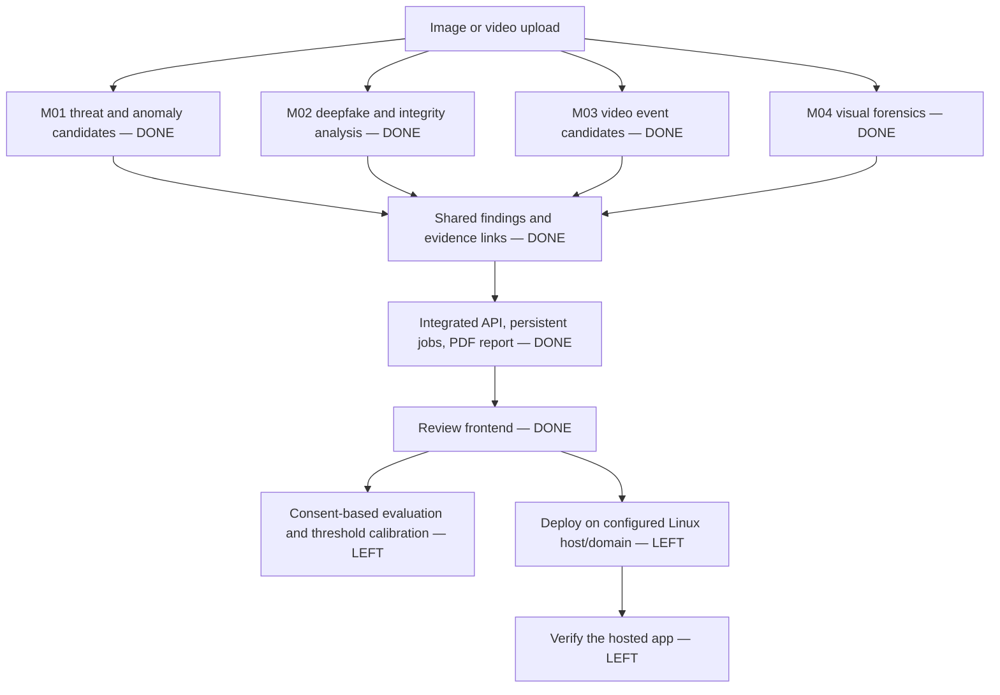

# DEEP SHIELD — Project Status

**Last reviewed:** 2026-11-18

**Repository:** [Raghav-prog-max/Deep-Shield](https://github.com/Raghav-prog-max/Deep-Shield)

**Status:** Core engines, integration API, frontend, and single-host durable queue are implemented. Formal model evaluation and public hosting remain outstanding.

## Project flow

## Done

| Area | Current state | Evidence/status |
|---|---|---|
| M01 — threat and anomaly | YOLO26n object detection, ByteTrack, zone-entry, loitering and unattended-object candidates | Implemented; thresholds are starting values and need local validation. |
| M02 — deepfake and integrity | Face manipulation model, experimental whole-image synthetic-image task, and image/video integrity evidence | Implemented; M02 evaluation tooling is in `scripts/evaluate_m02.py`. No representative labeled set is currently checked in. |
| M03 — video events | Rule-based zone, loitering, crowding and rapid-movement candidates | Implemented; optional GRU is not included. Event thresholds have not been validated on representative video. |
| M04 — visual forensics | Copy-move, ELA/noise maps, JPEG and metadata observations | Implemented; outputs are advisory visual evidence. |
| Integration API | Runs the applicable modules, keeps module scores separate, links findings and evidence, and stores job results | Implemented under `/api/v1/intelligence`. |
| Durable job handling | SQLite-backed queue, separate worker process, leases, heartbeat, and recovery after a worker interruption | Implemented for one host with persistent storage. It is not a multi-host queue. |
| Reports | PDF report endpoint with media hash, module status, groups, findings, evidence references and limitations | Implemented at `/api/v1/intelligence/jobs/{job_id}/report.pdf`. |
| Frontend | Upload, job status, module summaries, findings, evidence links, and PDF download | Implemented and locally verified at `http://127.0.0.1:3000`. |
| Local verification | Frontend typecheck/build and dependency audit pass; a real image job completed through the frontend proxy and returned a PDF; stale-worker recovery was exercised | Integration PR #4 previously recorded 21 passed and 1 skipped. The current deployment container has not been built. |
| GitHub integration | Engine, integration, and frontend/queue work are merged | PRs [#3](https://github.com/Raghav-prog-max/Deep-Shield/pull/3), [#4](https://github.com/Raghav-prog-max/Deep-Shield/pull/4), and [#5](https://github.com/Raghav-prog-max/Deep-Shield/pull/5) are merged. |

## Left to do

### 1. Evaluate the models and calibrate thresholds

There is no consented, labeled evaluation dataset in the repository. The checked-in image fixture is a smoke-test input, not accuracy evidence. Provide:

- For M02: labeled real/manipulated face images and real/synthetic images, with source, consent/use basis, license, and a held-out split.
- For M01/M03: representative consented videos, event labels with start/end times, and zone definitions where needed. Object-detection evaluation also needs labeled boxes/classes.

Use separate calibration and held-out test sets. Tune only against the calibration set; report the final metrics on held-out material. Until then, model results and rules remain advisory. See [EVALUATION.md](EVALUATION.md).

### 2. Deploy the app

The repository now has a Docker Compose setup with a separate API and worker, persistent data/model/evidence volumes, Caddy HTTPS, and password protection. A public deployment still needs:

- A Linux Docker host with enough disk and memory for the Python, PyTorch and model assets.
- A domain pointed at that host, with inbound ports 80 and 443 available.
- A private `.env.production` file with the site name and Basic Auth settings.

Docker Desktop's daemon was unavailable during the local run, so containers were not built or started here. See [DEPLOYMENT.md](DEPLOYMENT.md).

### 3. Verify the hosted deployment

After deploying, verify HTTPS and login, M01 health, an upload, job completion, evidence links, and PDF download. Also confirm that the persistent volumes survive a restart and that the worker resumes an interrupted queued job.

### 4. Decide follow-up production work

- Define media/evidence retention and deletion before storing operational footage. Uploaded job source files are removed after processing; generated evidence and job results are retained.
- The SQLite queue is for a single host. Move to PostgreSQL, a broker, and shared object storage before multi-host operation.
- Add the optional M03 GRU only if it remains part of the product requirements; it is not part of the current rule-based engine.

## Pull-request housekeeping

PR #1 was an earlier backend starter that predates the four engines and current integration. Its README said the engines were unavailable, and its separate `backend/` implementation would duplicate and contradict the current system. It was closed as superseded; the production-relevant work from later stages is already merged in PRs #3–#5.

## Safety and limitations

The app does not identify people or infer intent or wrongdoing. Scores are not calibrated probabilities. M01/M03 thresholds and M02 classifier thresholds must not be treated as operationally validated until evaluated on representative, consented media.
