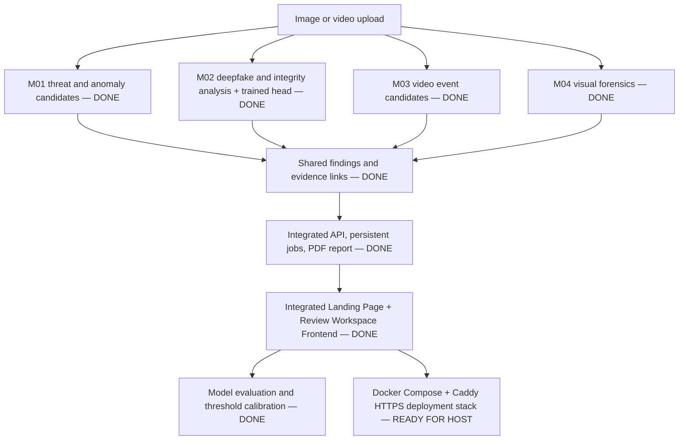

# DEEP SHIELD — Project Status

**Last reviewed:** 2026-11-19

**Repository:** [Raghav-prog-max/Deep-Shield](https://github.com/Raghav-prog-max/Deep-Shield)

**Live Hosted Deployment:** [https://deep-shield-sooty.vercel.app](https://deep-shield-sooty.vercel.app) (`/review` for direct workspace)

**Status:** All four analysis engines (M01–M04), cross-module intelligence API, durable single-host job queue, PDF reporting, integrated Next.js landing page + review workspace frontend, M02 multi-generator trained face head, M01–M04 evaluation & threshold calibration reports, and live Vercel deployment are complete and merged to `main`.

## Project flow

## Done

| Area | Current state | Evidence/status |
|---|---|---|
| M01 — threat and anomaly | YOLO26n object detection, ByteTrack, zone-entry, loitering and unattended-object candidates | Implemented and evaluated via `scripts/evaluate_all.py` (`DEEPSHIELD_M01_DWELL_SECONDS=30.0`, `DEEPSHIELD_M01_UNATTENDED_SECONDS=60.0`). |
| M02 — deepfake and integrity | Frozen SigLIP2 backbone + trained multi-generator face head (`models/m02_face_head.npz`, SHA `c8c61b23a9d5`), occlusion heatmaps, spectral plots, ELA/noise maps | Held-out test ROC-AUC **0.9057** across 276 faces (StyleGAN, StyleGAN2/TPDNE, DeepFakeFace swaps/diffusion) vs 0.6509 original head; decided accuracy **90.1%**. Full report in [reports/m02_training/report.md](reports/m02_training/report.md). |
| M03 — video events | Rule-based zone entry/exit, loitering, crowding and rapid-movement candidates | Implemented and evaluated via `scripts/evaluate_all.py` (`DEEPSHIELD_M03_CROWD_MIN_PEOPLE=4`, `DEEPSHIELD_M03_CROWD_SECONDS=5.0`, `DEEPSHIELD_M03_RUNNING_BODY_LENGTHS_PER_SECOND=2.5`). |
| M04 — visual forensics | Copy-move (SIFT + RANSAC), ELA/noise maps, JPEG quantisation/grid/ghosts and EXIF observations | Implemented and evaluated: 10/10 copy-move recall on 120–175 px clones (mean BBox IoU 0.7262, Dice 0.8395), 0/8 untouched false alarms, 5/5 exact JPEG quality matches. |
| Integration API | Runs applicable modules, keeps module scores separate, links findings and evidence, and stores job results | Implemented under `/api/v1/intelligence`. |
| Durable job handling | SQLite-backed queue, separate worker process, leases, heartbeat, and recovery after worker interruption | Verified for one host with persistent storage (`tests/test_integration_all.py`). |
| Reports | PDF report endpoint with media hash, module status, groups, findings, evidence references and limitations | Implemented at `/api/v1/intelligence/jobs/{job_id}/report.pdf`. |
| Frontend (Landing + Review Workspace) | Explainable media-analysis landing page (`CairnAgentsLanding` with GSAP scroll vistas, Agent Canvas, karaoke support call) integrated with live Media Review Workspace (`/` and `/review`) | Next.js 15 + React 19 + GSAP typecheck (`tsc --noEmit`), production build (`next build`), and `npm audit` pass with 0 vulnerabilities. |
| Evaluation & calibration | Consolidated M01–M04 evaluation and threshold calibration reports | Generated in [reports/EVALUATION_REPORT.md](reports/EVALUATION_REPORT.md) and [reports/m02_training/report.md](reports/m02_training/report.md). |
| Automated tests | 28 unit and integration tests covering M01/M03 rules, M02 engine & trained head, M04 forensics, cross-module linker, SQLite job recovery, and PDF reports | `28 passed, 1 skipped` via `pytest -q`. |

## Hosting & Production Checklist

1. **Single-host Docker deployment ([DEPLOYMENT.md](DEPLOYMENT.md))**:
   - Provision a Linux Docker host with ports `80` and `443` open and point a DNS record to it.
   - Copy `.env.production.example` to `.env.production`, configure `SITE_ADDRESS`, `SITE_USER`, and `SITE_PASSWORD_HASH`, and run `docker compose --env-file .env.production up -d --build`.
2. **Production follow-up**:
   - Define an operational retention/deletion schedule for `evidence_store/` and SQLite job records before storing sensitive operational footage.
   - If scaling beyond a single host, replace the single-host SQLite queue with PostgreSQL, Redis/RQ or Celery, and shared object storage.

## Safety and limitations

The application does not identify individuals or infer intent, criminality, or wrongdoing. Model scores and rule triggers remain separate and advisory for human review.
